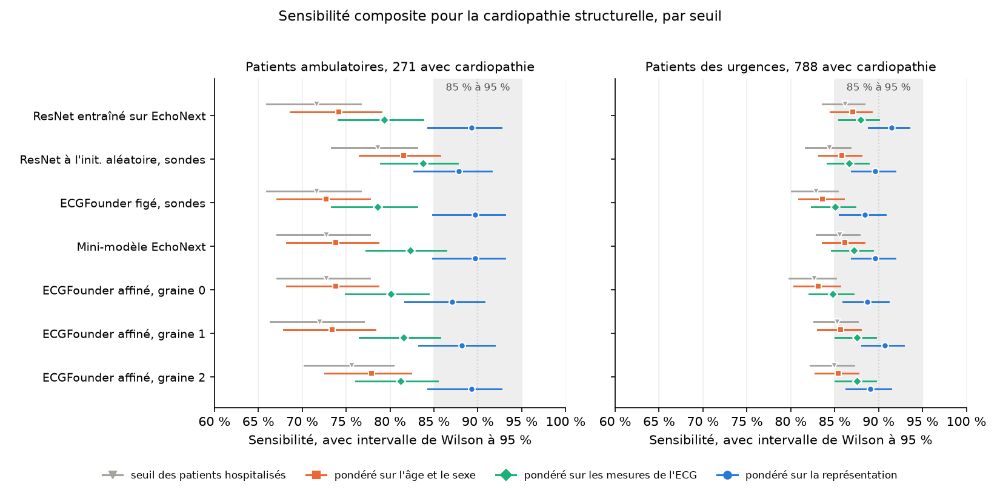

# Recalibration sans étiquettes d'un seuil ECG pour la cardiopathie structurelle d'un lieu de soins à l'autre : la prédiction conforme pondérée dans EchoNext

Ruben Abbou · novembre 2026

## Résumé

**Contexte.** Les modèles ECG de la cardiopathie structurelle (CS) s'appliquent à un seuil fixé pour une sensibilité cible dans la population de dérivation. À Columbia, le seuil fixé pour une sensibilité de 90 % chez les patients hospitalisés détectait 71,6 % des CS chez les patients ambulatoires pour un ResNet entraîné sur EchoNext. Recalibrer le seuil exige d'ordinaire des patients ambulatoires dont le diagnostic échocardiographique est connu. La prédiction conforme pondérée recalibre sans diagnostic cible sous décalage de covariables, à condition que la probabilité de CS sachant l'ECG soit la même dans les deux lieux de soins.

**Méthode.** Étude rétrospective dans EchoNext v1.1.1, rapportée selon TRIPOD+AI. Sept modèles ont été calibrés sur 1 903 ECG de patients hospitalisés et évalués chez 1 059 patients ambulatoires, dont 271 avec une CS, et chez 1 971 patients des urgences, dont 788 avec une CS. Les seuils conformes par classe ont été repondérés par un classifieur de domaine ajusté sur l'âge et le sexe, sur sept mesures ECG ou sur la représentation figée d'ECGFounder. Le critère préspécifié exigeait que l'intervalle de Wilson à 95 % de la sensibilité composite, à la taille d'échantillon effective, soit compris entre 85 % et 95 %, et qu'une majorité des anomalies échocardiographiques jugées dépasse 80 %.

**Résultats.** La pondération sur l'âge et le sexe donnait chez les patients ambulatoires des sensibilités de 72,7 % à 81,5 % selon les modèles, contre 71,6 % à 78,6 % au seuil des patients hospitalisés ; la pondération sur la représentation donnait 87,1 % à 89,7 %, avec des bornes basses de 81,7 % à 84,9 % à 213 cas effectifs. Aucun modèle n'atteignait le critère à cette taille, à laquelle il n'est atteint que pour une sensibilité observée de 90,1 % à 92,0 %, et une recalibration exactement à 90 % l'atteint avec une probabilité de 0,40 ; aux 271 cas ambulatoires, deux modèles l'atteignaient. Chez les patients des urgences, la pondération sur la représentation donnait 88,5 % à 91,5 %, et les sept modèles atteignaient le critère. Les seuils pondérés signalaient 60,0 % à 75,3 % des patients ambulatoires, contre 36,4 % à 51,8 % au seuil des patients hospitalisés, et la spécificité baissait de 57,4 %–76,0 % à 29,1 %–49,7 %. ECGFounder affiné sur EchoNext atteignait 72,0 % à 75,6 % au seuil des patients hospitalisés.

**Conclusions.** La pondération pour décalage de covariables sur la représentation d'un modèle de fondation ECG rapprochait de 90 % la sensibilité pour la CS chez les patients ambulatoires et les patients des urgences sans diagnostic cible, au prix du signalement de la plupart des patients ambulatoires. Chez les patients ambulatoires, l'échantillon était trop petit pour établir si le seuil recalibré atteignait sa cible.

## 1. Introduction

Les modèles ECG de la CS sont dérivés chez des patients ayant eu une échocardiographie et appliqués à un seuil fixé pour une sensibilité cible dans la population de dérivation. L'étude EchoNext rapporte l'ASC du modèle par lieu de soins, mais pas la sensibilité d'un seuil fixe dans chaque lieu [1]. Dans une réanalyse d'EchoNext, un seuil fixé pour une sensibilité de 90 % chez les patients hospitalisés de Columbia détectait 71,6 % des patients ambulatoires atteints de CS alors que l'ASC était conservée [2] : les scores des patients ambulatoires étaient plus bas, et le point de fonctionnement se déplaçait. Une validation externe du mini-modèle EchoNext dans MIMIC-IV a rapporté son ASC par lieu de soins et l'a recalibré sur des étiquettes locales, sans seuils conformes [3]. La recalibration sur des patients étiquetés rétablit le point de fonctionnement, mais exige des échocardiographies dans le lieu de soins cible.

La prédiction conforme fractionnée place un seuil à un quantile des scores de calibration et garantit au moins la couverture annoncée quand les patients de calibration et les patients cibles sont échangeables [4] ; calculée dans chaque classe, elle garantit une sensibilité [5]. La prédiction conforme pondérée étend la garantie au décalage de covariables en pondérant chaque patient de calibration par le rapport de vraisemblance des covariables cibles et sources, estimable à partir d'ECG cibles non étiquetés [6]. La garantie exige que la probabilité du critère sachant les covariables soit la même dans les deux populations. Des recherches dans arXiv et Europe PMC le 20 octobre 2026 n'ont identifié aucune étude appliquant la prédiction conforme à EchoNext.

Nous avons examiné si des seuils conformes pondérés, fixés sans diagnostic des patients ambulatoires, rétablissent une sensibilité de 90 % pour la CS chez les patients ambulatoires de Columbia, pour sept modèles et trois jeux de covariables.

## 2. Méthodes

Cette étude rétrospective porte sur des modèles de classification ECG transférés entre les lieux de soins d'un même système hospitalier et est rapportée selon la recommandation TRIPOD+AI [7]. Ses critères de décision ont été fixés dans un protocole daté du 16 octobre 2026, avant la lecture de tout résultat.

### 2.1 Participants et critère de jugement

EchoNext v1.1.1 contient 100 000 ECG de Columbia, chacun apparié à une échocardiographie transthoracique dans l'année, qui fournit onze anomalies échocardiographiques et leur composite, la CS modérée ou plus [1]. Les partitions publiées ont été utilisées telles quelles. Les modèles ont été entraînés sur 72 475 ECG et calibrés sur les 1 903 ECG de patients hospitalisés de la partition de validation. La partition de test fournissait trois cohortes cibles, avec un ECG par patient : 2 203 patients hospitalisés, 1 971 patients des urgences, dont 788 avec une CS, et 1 059 patients ambulatoires, dont 271 avec une CS. Aucun patient ne figure dans deux cohortes.

### 2.2 Modèles

Sept modèles ont été comparés. Quatre viennent de la réanalyse antérieure [2] :

- un ResNet entraîné sur EchoNext ;
- le même ResNet figé à une initialisation aléatoire fixée par graine, avec une régression logistique par anomalie ajustée sur ses caractéristiques (une sonde linéaire), comme témoin négatif ;
- ECGFounder (Net1D, 30,8 millions de paramètres) [8], figé, avec les mêmes sondes ;
- le mini-modèle EchoNext publié, avec les poids de ses auteurs [1].

Les trois autres affinent ECGFounder de bout en bout sur EchoNext à partir de ses poids publiés, avec une tête à douze sorties : AdamW à un taux d'apprentissage de 1e-4, une décroissance des poids de 0,01, un calendrier cosinus, des lots de 64 et dix époques, sous les graines 0, 1 et 2. L'époque retenue maximisait l'ASC moyenne sur le dixième des patients d'entraînement mis de côté par le ResNet. Les trois graines ont retenu l'époque 2 (ASC moyenne de contrôle de 0,781, 0,780 et 0,779), après laquelle l'ASC de contrôle baissait tandis que la perte d'entraînement continuait de diminuer. L'entraînement a utilisé PyTorch 2.2.2 sur un GPU, en 2,4 à 4,0 heures par graine.

### 2.3 Poids de décalage de covariables

Les poids viennent d'un classifieur de domaine entraîné à distinguer les patients hospitalisés de calibration des ECG non étiquetés du lieu de soins cible : une régression logistique pénalisée L2 sur des covariables standardisées, la pénalité étant choisie par validation croisée à cinq plis sur la perte logarithmique, et la prédiction de chaque ECG venant d'un modèle ajusté sans lui (ajustement croisé à cinq plis). Le poids w(x) est la cote du classifieur, remise à l'échelle des tailles de cohorte et plafonnée au 99e centile des poids de calibration. Tous les modèles partagent les mêmes poids et ne diffèrent que par leurs scores.

Trois jeux de covariables ont été comparés :

- l'âge et le sexe, référence basse, car la probabilité de CS sachant l'âge et le sexe seuls a peu de chances d'être invariante d'un lieu de soins à l'autre ;
- les sept mesures ECG distribuées avec EchoNext : l'âge, le sexe, les fréquences ventriculaire et auriculaire, et les intervalles PR, QRS et QTc ;
- la représentation figée d'ECGFounder, les 1 024 caractéristiques que le réseau préentraîné calcule à partir de chaque tracé.

Si la probabilité de CS sachant l'ECG est la même dans les deux lieux de soins, le rapport des densités de covariables cibles et hospitalières chez les cas égale w(x) à une constante près. Le quantile conforme de chaque classe est donc pondéré par w(x) seul, et la constante s'annule. L'ASC du classifieur de domaine mesure le décalage de covariables entre chaque cible et les patients hospitalisés de calibration.

### 2.4 Seuils et signalements

Pour chaque anomalie et pour le composite, des seuils conformes par classe ont été fixés pour une sensibilité de 90 % sur les patients hospitalisés de calibration, soit sans pondération (le seuil des patients hospitalisés), soit pondérés par w(x). Un ECG est signalé quand la CS figure dans son ensemble conforme, y compris les ensembles qui contiennent les deux classes. La sensibilité, la spécificité, la proportion d'ECG signalés et la VPP sont rapportées avec des intervalles de Wilson à 95 % [9].

### 2.5 Critères préspécifiés

Une anomalie était jugée quand elle comptait au moins 50 cas dans la cible. Chez les patients ambulatoires, quatre l'étaient : FEVG inférieure ou égale à 45 % (70 cas), épaisseur pariétale du VG d'au moins 13 mm (146), rétrécissement aortique modéré ou plus (51) et PAPS d'au moins 45 mmHg (63).

La recalibration pondérée sur la représentation atteint le critère principal quand deux conditions sont réunies : l'intervalle de Wilson à 95 % de la sensibilité composite est compris entre 85 % et 95 %, et une majorité stricte des anomalies jugées dépasse 80 % de sensibilité dans un test du score unilatéral à 0,025, avec la correction de Holm [10].

Les deux conditions sont évaluées à la taille d'échantillon effective, que le protocole ne définit pas. La pondération concentre le seuil sur peu de cas de calibration ; la taille effective de Kish est le nombre de cas de poids égaux auquel l'échantillon pondéré équivaut [11]. Deux lectures sont rapportées. La lecture principale prend la plus petite de la taille de Kish et du nombre de cas cibles, puisque le seuil pondéré repose sur les cas de calibration : 213 chez les patients ambulatoires. La seconde prend le nombre de cas cibles, sur lesquels la sensibilité est mesurée : 271. La condition composite a un plancher et un plafond : à 213 cas, elle n'est remplie que pour une sensibilité observée de 90,1 % à 92,0 %, car la borne basse n'atteint 85 % qu'au-dessus de 90 % et la borne haute dépasse 95 % au-dessus de 92,0 %. Une recalibration exactement sur la cible la remplit donc avec une probabilité de 0,40, et de 0,61 à 271 cas (tableau 2).

Le protocole jugeait le critère chez les patients ambulatoires. La cohorte des urgences, dont les poids et les sensibilités ont été calculés dans la même analyse, est rapportée comme cible secondaire, jugée selon les mêmes règles après la lecture des résultats ambulatoires. Huit anomalies comptaient au moins 50 cas aux urgences : FEVG inférieure ou égale à 45 % (310), épaisseur pariétale du VG d'au moins 13 mm (392), rétrécissement aortique modéré ou plus (66), insuffisance mitrale (119), insuffisance tricuspide (131) et dysfonction du VD (145), PAPS d'au moins 45 mmHg (275) et vitesse maximale d'IT d'au moins 3,2 m/s (147). La taille effective selon la lecture principale est de 571, à laquelle la probabilité ci-dessus est de 0,94.

L'affinage devait réduire de moitié la perte de sensibilité composite chez les patients ambulatoires au seuil des patients hospitalisés : pour chacune des trois graines, la borne haute de la perte, 90 % moins la borne basse de Wilson, devait être d'au plus 9 points.

### 2.6 Recalibration du seuil sur des étiquettes locales

Comme référence étiquetée, les seuils par anomalie ont été recalibrés sur n patients ambulatoires étiquetés tirés d'une moitié des patients ambulatoires et évalués sur l'autre moitié, pour n de 25 à 400, sur 200 tirages.

### 2.7 Calibration et prédiction sélective

Pour chaque modèle, anomalie et lieu de soins, la calibration est rapportée par la pente de calibration, la calibration globale, l'indice de calibration intégré (ICI) [12], ici avec un lissage à noyau gaussien sur le logit p à la place du loess, et le score de Brier. La confiance est la distance au seuil des patients hospitalisés sur l'échelle logit. S'abstenir sur les ECG les moins sûrs trace une courbe risque-couverture, résumée par son aire généralisée (AUGRC) [13] et par la sensibilité conservée à 80 % de couverture. Les intervalles sont les 2,5e et 97,5e percentiles de 500 rééchantillonnages bootstrap des ECG cibles, le seuil restant fixe.

## 3. Résultats

### 3.1 Le décalage de covariables était le plus grand chez les patients ambulatoires et sur la représentation

Le classifieur de domaine séparait mieux les patients ambulatoires que les patients des urgences des patients hospitalisés de calibration, et mieux sur la représentation que sur l'âge et le sexe (tableau 1). Entre deux échantillons de patients hospitalisés, il ne faisait pas mieux que le hasard.

Tableau 1. ASC du classifieur de domaine séparant les patients hospitalisés de calibration de chaque cible, par jeu de covariables. La ligne des patients hospitalisés compare deux échantillons d'une même population et sert de témoin négatif.

| Cible | âge, sexe | mesures ECG | représentation |
|---|---|---|---|
| patients hospitalisés | 0,499 | 0,504 | 0,485 |
| urgences | 0,552 | 0,590 | 0,768 |
| patients ambulatoires | 0,576 | 0,728 | 0,836 |

### 3.2 La pondération sur la représentation rapprochait la sensibilité de 90 %

Au seuil des patients hospitalisés, les sept modèles détectaient 71,6 % à 78,6 % des patients ambulatoires avec une CS et 82,6 % à 86,2 % des patients des urgences avec une CS (figure 1). La pondération sur l'âge et le sexe modifiait la sensibilité ambulatoire de 3 points au plus, et la pondération sur les mesures ECG donnait 78,6 % à 83,8 %. La pondération sur la représentation donnait 87,1 % à 89,7 % chez les patients ambulatoires, avec des bornes basses de 81,7 % à 84,9 % à 213 cas effectifs, et 88,5 % à 91,5 % chez les patients des urgences, avec des bornes basses de 85,6 % à 88,8 % à 571.

Figure 1. Sensibilité composite pour la CS de chaque modèle au seuil des patients hospitalisés et aux trois seuils pondérés, avec intervalles de Wilson à 95 % ; pour les seuils pondérés, l'intervalle est à la taille effective selon la lecture principale. La bande grisée est l'intervalle de 85 % à 95 % de la condition composite, la ligne pointillée la cible de 90 %. Valeurs par modèle : tableaux S1 et S3 du supplément.

Pondérée sur la représentation, chaque anomalie jugée chez les patients ambulatoires était détectée dans au moins 81,0 % de ses cas, et le rétrécissement aortique dans 94,1 % à 100,0 % (tableau S2). Chez les patients des urgences, la vitesse maximale d'IT d'au moins 3,2 m/s était l'anomalie la moins bien détectée, à 75,5 % à 90,5 % (tableau S4).

### 3.3 Le verdict ambulatoire dépendait de la lecture de la taille effective

À 213 cas ambulatoires, aucun modèle n'atteignait le critère. À 271, deux l'atteignaient : ECGFounder figé, dont l'intervalle allait de 85,5 % à 92,8 % avec quatre anomalies sur quatre au-dessus de 80 %, et ECGFounder affiné sous la graine 2, à 85,1 % à 92,4 % avec trois sur quatre (tableau S5). Chez les patients des urgences, les sept modèles l'atteignaient selon les deux lectures.

La condition composite a un plafond autant qu'un plancher, et aux tailles ambulatoires l'intervalle des sensibilités observées qui la remplissent est étroit (tableau 2). À 213 cas, il exclut 90 % même : une recalibration exactement sur la cible la remplit avec une probabilité de 0,40, contre 0,94 aux 571 cas des urgences.

Tableau 2. Sensibilités composites observées pour lesquelles l'intervalle de Wilson à 95 % est compris entre 85 % et 95 %, à la taille de chaque lecture, et probabilité d'une telle observation quand la sensibilité réelle est de 90 %.

| Cible | Lecture | n | Sensibilité remplissant la condition | Probabilité |
|---|---|---|---|---|
| patients ambulatoires | plus petit des cas et de la taille de Kish | 213 | 90,1 %–92,0 % | 0,40 |
| patients ambulatoires | cas cibles | 271 | 89,3 %–92,3 % | 0,61 |
| urgences | plus petit des cas et de la taille de Kish | 571 | 88,1 %–93,2 % | 0,94 |
| urgences | cas cibles | 788 | 87,6 %–93,4 % | 0,99 |

### 3.4 Les seuils pondérés signalaient plus de patients, à une spécificité plus basse

Les seuils pondérés atteignaient ces sensibilités en signalant plus de patients (tableau 3). Chez les patients ambulatoires, la proportion de signalés passait de 36,4 %–51,8 % à 60,0 %–75,3 % selon les modèles, la spécificité baissait de 57,4 %–76,0 % à 29,1 %–49,7 %, et la VPP de 38,8 %–51,0 % à 29,9 %–37,6 %. Chez les patients des urgences, la spécificité baissait de 54,5 %–65,4 % à 41,0 %–52,9 %. Aucun modèle ne gagnait en sensibilité à spécificité constante (tableau S6).

Tableau 3. Le signalement composite au seuil des patients hospitalisés et au seuil pondéré sur la représentation : plus basse et plus haute valeur parmi les sept modèles.

| Cible | Seuil | Sensibilité | Spécificité | Signalés | VPP |
|---|---|---|---|---|---|
| patients ambulatoires | patients hospitalisés | 71,6 %–78,6 % | 57,4 %–76,0 % | 36,4 %–51,8 % | 38,8 %–51,0 % |
| patients ambulatoires | pondéré sur la représentation | 87,1 %–89,7 % | 29,1 %–49,7 % | 60,0 %–75,3 % | 29,9 %–37,6 % |
| urgences | patients hospitalisés | 82,6 %–86,2 % | 54,5 %–65,4 % | 53,8 %–61,0 % | 55,3 %–61,4 % |
| urgences | pondéré sur la représentation | 88,5 %–91,5 % | 41,0 %–52,9 % | 63,7 %–71,2 % | 50,3 %–55,7 % |

### 3.5 Recalibration du seuil sur des étiquettes locales

Les seuils recalibrés sur 100 ou 200 patients ambulatoires étiquetés atteignaient une sensibilité moyenne d'au moins 90 % pour cinq des sept modèles (tableau S7). Avec 25 ou 50 patients ambulatoires étiquetés, peu de cas étaient tirés, et le seuil recalibré signalait souvent tous les ECG.

### 3.6 Calibration et prédiction sélective

Quand le cinquième des ECG le moins confiant était mis de côté, la sensibilité parmi les autres restait supérieure à 93 % chez les patients hospitalisés pour tous les modèles, et allait de 76,3 % à 81,3 % chez les patients ambulatoires (tableau S8). La confiance dérivée des patients hospitalisés n'identifiait pas les cas ambulatoires manqués au seuil.

### 3.7 L'affinage d'ECGFounder ne réduisait pas la perte

ECGFounder affiné détectait 72,0 % à 75,6 % des patients ambulatoires avec une CS au seuil des patients hospitalisés selon les trois graines, soit une perte de 14,4 à 18,0 points contre 18,4 pour le ResNet. La borne haute de la perte dépassait 9 points pour chaque graine (tableau S9) : la réduction de moitié préspécifiée n'était pas atteinte.

## 4. Discussion

### 4.1 Principaux résultats

La pondération sur la représentation d'ECGFounder faisait passer la sensibilité composite pour la CS de 71,6 %–78,6 % à 87,1 %–89,7 % chez les patients ambulatoires et de 82,6 %–86,2 % à 88,5 %–91,5 % chez les patients des urgences, sans diagnostic cible. Chez les patients ambulatoires, aucun modèle n'atteignait le critère préspécifié selon la lecture principale, mais à 213 cas effectifs le critère n'est atteint que pour une sensibilité observée de 90,1 % à 92,0 %, intervalle qui exclut la cible de 90 % elle-même, et une recalibration exactement sur la cible l'atteint avec une probabilité de 0,40 ; le résultat ambulatoire est donc non concluant plutôt que négatif. Aux 271 cas ambulatoires, deux modèles l'atteignaient, et chez les patients des urgences, où cette probabilité est de 0,94, les sept l'atteignaient. Les seuils pondérés obtenaient ces sensibilités en signalant plus de patients : 60,0 % à 75,3 % des patients ambulatoires, à une spécificité de 29,1 % à 49,7 %. L'affinage d'ECGFounder sur EchoNext ne réduisait pas la perte de sensibilité au seuil des patients hospitalisés : 14,4 à 18,0 points selon les graines, contre 18,4 pour le ResNet.

### 4.2 Comparaison avec les travaux antérieurs

La validation externe du mini-modèle EchoNext dans MIMIC-IV a rapporté son ASC par lieu de soins et l'a recalibré sur des étiquettes locales, sans seuils conformes [3]. Ici, des seuils recalibrés sur 100 à 200 patients ambulatoires étiquetés atteignaient une sensibilité moyenne d'au moins 90 % pour cinq des sept modèles, au prix de leurs échocardiographies. Une étude du tri de la CS tenant compte de l'incertitude sur EchoNext ne rapporte, dans son résumé, ni seuils conformes ni comparaison des lieux de soins [14]. La borne de Han et Qu sur la couverture par classe sans étiquettes sous décalage [15] est compatible avec le déficit résiduel chez les patients ambulatoires, mais n'est pas démontrée par lui. Deux explications sont compatibles avec ce déficit : la probabilité de CS sachant l'ECG peut différer entre lieux de soins, ce qui viole l'hypothèse de décalage de covariables [6], ou la représentation peut ne pas coder les caractéristiques sur lesquelles les lieux diffèrent. Le gain plus grand obtenu avec la représentation qu'avec l'âge et le sexe suggère que le décalage porte surtout sur la morphologie de l'ECG plutôt que sur la démographie.

### 4.3 Forces et limites

Le critère a été fixé avant la lecture de tout résultat. Sept modèles, dont un témoin négatif non entraîné et trois graines affinées, ont été évalués sur les mêmes patients avec un seul examen de référence, face à trois jeux de covariables et à une référence étiquetée.

Le résultat vient d'un seul système hospitalier, et son ampleur dans un second système est inconnue ; un transfert de Columbia vers Boston attend l'accès accrédité à MIMIC-IV-Echo. Le protocole ne définit pas la taille effective, et aucune des deux lectures rapportées n'est celle du protocole. La cohorte des urgences a été jugée après la lecture des résultats ambulatoires, et son verdict est secondaire. Le protocole ne fixait aucune borne de spécificité ni de VPP ; le coût du signalement est donc décrit, non jugé. Les poids utilisent la représentation figée d'ECGFounder pour tous les modèles, y compris ceux qui ne la lisent pas. L'audit de la couverture sans étiquettes sur les étiquettes cibles prévu par le protocole n'a pas été mis en œuvre ; les seuils recalibrés sur des patients ambulatoires étiquetés servent de référence étiquetée à sa place. Trois items de TRIPOD+AI ne sont pas couverts : la justification de la taille d'échantillon, le traitement des données manquantes (aucune dans les covariables utilisées) et un protocole de mise à jour du modèle après déploiement.

### 4.4 Implications pour la pratique et la recherche

Un site disposant d'ECG non étiquetés peut rapprocher un seuil livré de sa sensibilité cible en pondérant sur la représentation d'un modèle de fondation, mais le seuil pondéré signale plus de patients, et le nombre d'échocardiographies par cas détecté qui en résulte doit être mis en regard des cas manqués au seuil livré. Dans cette cohorte, la recalibration sans étiquettes ne remplaçait pas un échantillon étiqueté de 100 à 200 patients ambulatoires. Une étude de confirmation préspécifierait la taille effective et une borne de spécificité, et exigerait plusieurs centaines de cas cibles pour que le critère d'intervalle ait une puissance suffisante.

Il s'agit d'une étude rétrospective sur des données publiques et désidentifiées. Rien ici n'est destiné à guider la prise en charge d'un patient.

## Déclarations

**Liens d'intérêts.** L'auteur a travaillé chez Idoven, qui développe des logiciels d'analyse de l'ECG, et chez Anumana, qui commercialise les travaux d'ECG par intelligence artificielle de la Mayo Clinic. Aucune des deux sociétés n'a pris part à la conception, à la conduite, au financement ou au compte rendu de cette étude, et aucune de leurs données, aucun de leurs modèles ni de leurs logiciels n'a été utilisé.

**Financement.** Aucun.

**Données.** EchoNext est distribué par PhysioNet sous sa Restricted Health Data License ; ses tracés, et les scores, représentations, poids et modèles affinés qui en dérivent, restent hors de ce dépôt, qui ne contient que des effectifs et des valeurs agrégées.

**Éthique.** Cette étude est une analyse secondaire de données ECG publiques et désidentifiées, sans aucun contact avec des patients. L'essai DISCOVERY et ses analyses ont été approuvés par l'Institutional Review Board du NewYork-Presbyterian Hospital/Columbia University Irving Medical Center, comme l'indique la page PhysioNet d'EchoNext ; aucun numéro d'approbation n'y figure. Aucune tentative de réidentification n'a été faite.

**Code et chiffres.** `scripts/structure.py` calcule les fichiers de résultats de `results/` à partir des scores ; `scripts/structure_pages.py` produit à partir d'eux chaque tableau de la version anglaise et de son supplément, `STRUCTURE_SUPPLEMENT.md`, ainsi que la figure 1. `tests/test_structure_results.py` échoue si un tableau ou un pourcentage de l'un des textes anglais s'écarte de ces fichiers, et `tests/test_structure_fr.py` échoue si cette traduction ne porte pas les mêmes chiffres. Les sommes SHA-256 des modèles affinés sont enregistrées avec leurs scores.

## Références

1. Poterucha TJ, Jing L, Ricart RP, et al. Detecting structural heart disease from electrocardiograms using AI. *Nature* 2025;644(8075):221-230. doi:10.1038/s41586-025-09227-0.
2. Abbou R. Predicting an ECG model's positive predictive value from a clinic's prevalence: a retrospective measurement across hospitals and care settings. 2026. https://github.com/rabbou/ecg-ai-portability.
3. Otabor E, Hassan A, Okunlola A, et al. Transportability of an artificial intelligence electrocardiography model for structural heart disease: external validation and recalibration of EchoNext-Mini in MIMIC-IV. *Eur Heart J Digit Health* 2026;7(8):ztag147. doi:10.1093/ehjdh/ztag147.
4. Angelopoulos AN, Bates S. Conformal prediction: a gentle introduction. *Found Trends Mach Learn* 2023;16(4):494-591. doi:10.1561/2200000101.
5. Vovk V. Conditional validity of inductive conformal predictors. In: *Proceedings of the Asian Conference on Machine Learning*. PMLR 2012;25:475-490.
6. Tibshirani RJ, Foygel Barber R, Candès EJ, Ramdas A. Conformal prediction under covariate shift. In: *Advances in Neural Information Processing Systems 32 (NeurIPS 2019)*. arXiv:1904.06019.
7. Collins GS, Moons KGM, Dhiman P, et al. TRIPOD+AI statement: updated guidance for reporting clinical prediction models that use regression or machine learning methods. *BMJ* 2024;385:e078378. doi:10.1136/bmj-2023-078378.
8. Li J, Aguirre AD, Moura Junior V, et al. An electrocardiogram foundation model built on over 10 million recordings. *NEJM AI* 2025;2(7). doi:10.1056/AIoa2401033.
9. Wilson EB. Probable inference, the law of succession, and statistical inference. *J Am Stat Assoc* 1927;22(158):209-212. doi:10.1080/01621459.1927.10502953.
10. Holm S. A simple sequentially rejective multiple test procedure. *Scand J Stat* 1979;6:65-70. doi:10.2307/4615733.
11. Kish L. *Survey Sampling*. New York: Wiley; 1965.
12. Austin PC, Steyerberg EW. The Integrated Calibration Index (ICI) and related metrics for quantifying the calibration of logistic regression models. *Stat Med* 2019;38(21):4051-4065. doi:10.1002/sim.8281.
13. Traub J, Bungert TJ, Lüth CT, et al. Overcoming common flaws in the evaluation of selective classification systems. arXiv:2407.01032 [preprint]. 2024.
14. Colebank MJ. Uncertainty-aware classification and triage of structural heart disease using electrocardiography and echocardiography metrics. arXiv:2605.22968 [preprint]. 2026.
15. Han W, Qu L. The label complexity of class-conditional coverage under distribution shift. arXiv:2607.18088 [preprint]. 2026.
