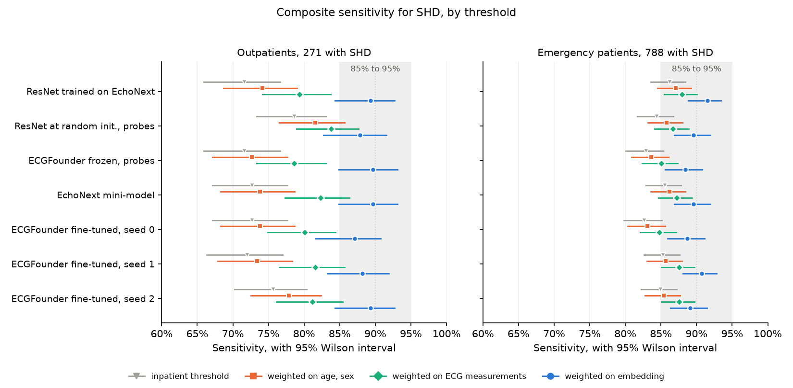

# Label-free recalibration of an ECG threshold for structural heart disease across care settings: weighted conformal prediction in EchoNext

Ruben Abbou · November 2026

## Abstract

**Background.** ECG models for structural heart disease (SHD) are applied at a threshold set for a target sensitivity in the derivation population. At Columbia, the threshold set for 90% sensitivity among inpatients detected 71.6% of SHD among outpatients for a ResNet trained on EchoNext. Recalibrating the threshold conventionally requires outpatients with echocardiographic diagnoses. Weighted conformal prediction recalibrates without target diagnoses under covariate shift, provided that the probability of SHD given the ECG is the same in both settings.

**Methods.** Retrospective study in EchoNext v1.1.1, reported following TRIPOD+AI. Seven models were calibrated on 1,903 inpatient ECGs and evaluated on 1,059 outpatients, 271 of them with SHD, and on 1,971 emergency patients, 788 with SHD. Class-conditional conformal thresholds were reweighted by a domain classifier fitted on age and sex, on seven ECG measurements, or on the frozen ECGFounder embedding. The pre-specified criterion required the 95% Wilson interval of composite sensitivity, at the effective sample size, to lie within 85% to 95%, and a majority of judged echocardiographic findings to exceed 80%.

**Results.** Weighting on age and sex gave outpatient sensitivities of 72.7% to 81.5% across models, against 71.6% to 78.6% at the inpatient threshold; weighting on the embedding gave 87.1% to 89.7%, with lower bounds of 81.7% to 84.9% at 213 effective cases. No model met the criterion at that size, at which it is met only for an observed sensitivity of 90.1% to 92.0%, and a recalibration exactly at 90% meets it with probability 0.40; at the 271 outpatient cases, two models met it. Among emergency patients, weighting on the embedding gave 88.5% to 91.5%, and all seven models met the criterion. The weighted thresholds flagged 60.0% to 75.3% of outpatients, against 36.4% to 51.8% at the inpatient threshold, and specificity fell from 57.4%–76.0% to 29.1%–49.7%. ECGFounder fine-tuned on EchoNext reached 72.0% to 75.6% at the inpatient threshold.

**Conclusions.** Covariate-shift weighting on an ECG foundation-model embedding brought sensitivity for SHD close to 90% among outpatients and emergency patients without target diagnoses, at the cost of flagging most outpatients. Among outpatients, the sample was too small to establish whether the recalibrated threshold reached its target.

## 1. Introduction

ECG models for SHD are derived in patients with an echocardiogram and applied at a threshold set for a target sensitivity in the derivation population. The EchoNext study reports the model's AUROC by care setting but not the sensitivity of a fixed threshold in each setting [1]. In a re-analysis of EchoNext, a threshold set for 90% sensitivity among Columbia inpatients detected 71.6% of outpatients with SHD while the AUROC was preserved [2]: the outpatients' scores were lower, and the operating point moved. An external validation of the EchoNext mini-model in MIMIC-IV recalibrated it on local labels [3]. Recalibration on labelled patients restores the operating point but requires echocardiograms in the target setting.

Split conformal prediction sets a threshold at a quantile of calibration scores and guarantees at least the stated coverage when calibration and target patients are exchangeable [4]; computed within each class, it guarantees a sensitivity [5]. Weighted conformal prediction extends the guarantee to covariate shift by weighting each calibration patient by the likelihood ratio of target to source covariates, which can be estimated from unlabelled target ECGs [6]. The guarantee requires the probability of the outcome given the covariates to be the same in both populations. Searches of arXiv and Europe PMC on 20 October 2026 identified no study applying conformal prediction to EchoNext.

We examined whether weighted conformal thresholds, set without outpatient diagnoses, restore 90% sensitivity for SHD among Columbia outpatients, in seven models and three covariate sets.

## 2. Methods

This is a retrospective study of ECG classification models transferred between care settings of one hospital system, reported following the TRIPOD+AI guideline [7]. Its decision criteria were fixed in a protocol dated 16 October 2026, before any result was read.

### 2.1 Participants and outcome

EchoNext v1.1.1 holds 100,000 ECGs from Columbia, each paired with a transthoracic echocardiogram within one year, which yields eleven echocardiographic findings and their composite, moderate or greater SHD [1]. The published splits were used unchanged. Models were trained on 72,475 ECGs and calibrated on the 1,903 inpatient ECGs of the validation split. The test split gave three target cohorts, with one ECG per patient: 2,203 inpatients, 1,971 emergency patients, of whom 788 had SHD, and 1,059 outpatients, of whom 271 had SHD. No patient appears in two cohorts.

### 2.2 Models

Seven models were compared. Four come from the earlier re-analysis [2]:

- a ResNet trained on EchoNext;
- the same ResNet frozen at a seeded random initialisation, with one logistic regression per finding fitted on its features (a linear probe), as a negative control;
- ECGFounder (Net1D, 30.8 million parameters) [8], frozen, with the same probes;
- the published EchoNext mini-model, with its authors' weights [1].

The other three fine-tune ECGFounder end to end on EchoNext from its published weights, with a twelve-output head: AdamW at a learning rate of 1e-4, weight decay 0.01, a cosine schedule, batches of 64 and ten epochs, under seeds 0, 1 and 2. The epoch retained maximised the mean AUROC on the tenth of training patients held out by the ResNet. All three seeds retained epoch 2 (holdout mean AUROC 0.781, 0.780 and 0.779), after which the holdout AUROC declined while the training loss continued to fall. Training used PyTorch 2.2.2 on one GPU, in 2.4 to 4.0 hours per seed.

### 2.3 Covariate-shift weights

The weights come from a domain classifier trained to distinguish calibration inpatients from the unlabelled ECGs of the target setting: an L2-penalised logistic regression on standardised covariates, with the penalty chosen by five-fold cross-validation on log loss and each ECG's prediction taken from a model fitted without it (five-fold cross-fitting). The weight w(x) is the classifier's odds rescaled by the cohort sizes and capped at the 99th centile of the calibration weights. All models share the same weights and differ only in their scores.

Three covariate sets were compared:

- age and sex, a lower reference, since the probability of SHD given age and sex alone is unlikely to be invariant across care settings;
- the seven ECG measurements distributed with EchoNext: age, sex, ventricular and atrial rates, and PR, QRS and QTc intervals;
- the frozen ECGFounder embedding, the 1,024 features the pre-trained network computes from each tracing.

If the probability of SHD given the ECG is the same in both settings, the ratio of target to inpatient covariate densities among cases equals w(x) up to a constant. The conformal quantile of each class is therefore weighted by w(x) alone, and the constant cancels. The AUROC of the domain classifier measures the covariate shift between each target and the calibration inpatients.

### 2.4 Thresholds and flags

For each finding and for the composite, class-conditional conformal thresholds were set for 90% sensitivity on the calibration inpatients, either unweighted (the inpatient threshold) or weighted by w(x). An ECG is flagged when SHD is in its conformal set, including sets that hold both classes. Sensitivity, specificity, the proportion of ECGs flagged and the PPV are reported with 95% Wilson intervals [9].

### 2.5 Pre-specified criteria

A finding was judged when it counted at least 50 cases in the target. Among outpatients four did: LVEF at most 45% (70 cases), LV wall thickness at least 13 mm (146), moderate or greater aortic stenosis (51) and PASP at least 45 mmHg (63).

Recalibration with weights on the embedding meets the primary criterion when two conditions hold: the 95% Wilson interval of composite sensitivity lies within 85% to 95%, and a strict majority of judged findings exceeds 80% sensitivity in a one-sided score test at 0.025, with Holm's correction [10].

Both conditions are evaluated at the effective sample size, which the protocol does not define. Weighting concentrates the threshold on few calibration cases; the Kish effective sample size is the number of equally weighted cases to which the weighted sample is equivalent [11]. Two readings are reported. The primary reading takes the smaller of the Kish size and the target case count, since the weighted threshold rests on the calibration cases: 213 among outpatients. The second takes the target case count, on which sensitivity is measured: 271. The composite condition has a floor and a ceiling: at 213 cases it is met only for an observed sensitivity of 90.1% to 92.0%, since the lower bound reaches 85% only above 90% and the upper bound exceeds 95% above 92.0%. A recalibration exactly on target therefore meets it with probability 0.40, and with probability 0.61 at 271 cases (Table 2).

The protocol judged the criterion among outpatients. The emergency cohort, whose weights and sensitivities were computed in the same analysis, is reported as a secondary target, judged by the same rules after the outpatient results were read. Eight findings counted at least 50 emergency cases: LVEF at most 45% (310), LV wall thickness at least 13 mm (392), moderate or greater aortic stenosis (66), mitral regurgitation (119), tricuspid regurgitation (131) and RV dysfunction (145), PASP at least 45 mmHg (275) and peak TR velocity at least 3.2 m/s (147). The effective size under the primary reading is 571, at which the probability above is 0.94.

Fine-tuning was to halve the loss of composite sensitivity among outpatients at the inpatient threshold: for each of the three seeds, the upper bound of the loss, 90% minus the lower Wilson bound, had to be at most 9 points.

### 2.6 Threshold recalibration on local labels

As a labelled reference, the per-label thresholds were recalibrated on n labelled outpatients drawn from one half of the outpatients and evaluated on the other half, for n from 25 to 400, over 200 draws.

### 2.7 Calibration and selective prediction

For each model, finding and care setting, calibration is reported as the calibration slope, calibration-in-the-large, the integrated calibration index (ICI) [12], here with a Gaussian-kernel smoother on logit p in place of loess, and the Brier score. Confidence is the distance from the inpatient threshold on the logit scale. Abstaining on the least confident ECGs traces a risk-coverage curve, summarised by its generalised area (AUGRC) [13] and by the sensitivity retained at 80% coverage. Intervals are the 2.5th and 97.5th percentiles of 500 bootstrap resamples of target ECGs, with the threshold held fixed.

## 3. Results

### 3.1 The covariate shift was largest among outpatients and on the embedding

The domain classifier separated outpatients from the calibration inpatients better than it separated emergency patients, and better on the embedding than on age and sex (Table 1). On two samples of inpatients it did no better than chance.

Table 1. AUROC of the domain classifier separating calibration inpatients from each target, by covariate set. The inpatient row compares two samples of one population and is a negative control.

<!-- table:domain -->
| Target | age, sex | ECG measurements | embedding |
|---|---|---|---|
| inpatient | 0.499 | 0.504 | 0.485 |
| emergency | 0.552 | 0.590 | 0.768 |
| outpatient | 0.576 | 0.728 | 0.836 |
<!-- /table -->

### 3.2 Weighting on the embedding brought sensitivity close to 90%

At the inpatient threshold, the seven models detected 71.6% to 78.6% of outpatients with SHD and 82.6% to 86.2% of emergency patients with SHD (Figure 1). Weighting on age and sex changed outpatient sensitivity by at most 3 points, and weighting on the ECG measurements gave 78.6% to 83.8%. Weighting on the embedding gave 87.1% to 89.7% among outpatients, with lower bounds of 81.7% to 84.9% at 213 effective cases, and 88.5% to 91.5% among emergency patients, with lower bounds of 85.6% to 88.8% at 571.

Figure 1. Composite sensitivity for SHD of each model at the inpatient threshold and at the three weighted thresholds, with 95% Wilson intervals; for the weighted thresholds, the interval is at the effective size under the primary reading. The shaded band is the 85% to 95% of the composite condition, the dotted line the 90% target. Values per model: supplement Tables S1 and S3.

Weighted on the embedding, each judged finding among outpatients was detected in at least 81.0% of its cases, and aortic stenosis in 94.1% to 100.0% (Table S2). Among emergency patients, peak TR velocity at least 3.2 m/s was the weakest finding, at 75.5% to 90.5% (Table S4).

### 3.3 The outpatient verdict depended on the reading of the effective size

At 213 outpatient cases, no model met the criterion. At 271, two did: ECGFounder frozen, whose interval was 85.5% to 92.8% with four of four findings above 80%, and ECGFounder fine-tuned under seed 2, at 85.1% to 92.4% with three of four (Table S5). Among emergency patients, all seven models met it under both readings.

The composite condition has a ceiling as well as a floor, and at the outpatient sizes the range of observed sensitivities that meets it is narrow (Table 2). At 213 cases it excludes 90% itself: a recalibration exactly on target meets it with probability 0.40, against 0.94 at the 571 emergency cases.

Table 2. Observed composite sensitivities for which the 95% Wilson interval lies within 85% to 95%, at the size of each reading, and the probability of such an observation when the true sensitivity is 90%.

<!-- table:power -->
| Target | Reading | n | Sensitivity meeting the condition | Probability |
|---|---|---|---|---|
| outpatient | smaller of cases and Kish size | 213 | 90.1%–92.0% | 0.40 |
| outpatient | target cases | 271 | 89.3%–92.3% | 0.61 |
| emergency | smaller of cases and Kish size | 571 | 88.1%–93.2% | 0.94 |
| emergency | target cases | 788 | 87.6%–93.4% | 0.99 |
<!-- /table -->

### 3.4 Weighted thresholds flagged more patients at lower specificity

The weighted thresholds reached these sensitivities by flagging more patients (Table 3). Among outpatients, the proportion flagged rose from 36.4%–51.8% to 60.0%–75.3% across models, specificity fell from 57.4%–76.0% to 29.1%–49.7%, and PPV from 38.8%–51.0% to 29.9%–37.6%. Among emergency patients, specificity fell from 54.5%–65.4% to 41.0%–52.9%. No model gained sensitivity at constant specificity (Table S6).

Table 3. The composite flag at the inpatient threshold and at the threshold weighted on the embedding: lowest and highest value across the seven models.

<!-- table:flag_summary -->
| Target | Threshold | Sensitivity | Specificity | Flagged | PPV |
|---|---|---|---|---|---|
| outpatient | inpatient | 71.6%–78.6% | 57.4%–76.0% | 36.4%–51.8% | 38.8%–51.0% |
| outpatient | weighted on embedding | 87.1%–89.7% | 29.1%–49.7% | 60.0%–75.3% | 29.9%–37.6% |
| emergency | inpatient | 82.6%–86.2% | 54.5%–65.4% | 53.8%–61.0% | 55.3%–61.4% |
| emergency | weighted on embedding | 88.5%–91.5% | 41.0%–52.9% | 63.7%–71.2% | 50.3%–55.7% |
<!-- /table -->

### 3.5 Threshold recalibration on local labels

Thresholds recalibrated on 100 or 200 labelled outpatients reached a mean sensitivity of at least 90% for five of the seven models (Table S7). With 25 or 50 labelled outpatients, few cases were drawn, and the recalibrated threshold often flagged every ECG.

### 3.6 Calibration and selective prediction

When the least confident fifth of ECGs was set aside, sensitivity among the rest stayed above 93% among inpatients for every model, and ranged from 76.3% to 81.3% among outpatients (Table S8). Confidence derived from inpatients did not identify the outpatient cases missed at the threshold.

### 3.7 Fine-tuning ECGFounder did not reduce the loss

Fine-tuned ECGFounder detected 72.0% to 75.6% of outpatients with SHD at the inpatient threshold across the three seeds, a loss of 14.4 to 18.0 points against 18.4 for the ResNet. The upper bound of the loss exceeded 9 points for every seed (Table S9), so the pre-specified halving was not met.

## 4. Discussion

### 4.1 Principal findings

Weighting on the ECGFounder embedding raised composite sensitivity for SHD from 71.6%–78.6% to 87.1%–89.7% among outpatients and from 82.6%–86.2% to 88.5%–91.5% among emergency patients, without target diagnoses. Among outpatients, no model met the pre-specified criterion under the primary reading, but at 213 effective cases the criterion is met only for an observed sensitivity of 90.1% to 92.0%, a range that excludes the 90% target itself, and a recalibration exactly on target meets it with probability 0.40; the outpatient result is therefore inconclusive rather than negative. At the 271 outpatient cases two models met it, and among emergency patients, where that probability is 0.94, all seven did. The weighted thresholds reached these sensitivities by flagging more patients: 60.0% to 75.3% of outpatients, at a specificity of 29.1% to 49.7%. Fine-tuning ECGFounder on EchoNext did not reduce the loss of sensitivity at the inpatient threshold: 14.4 to 18.0 points across seeds, against 18.4 for the ResNet.

### 4.2 Comparison with prior work

The external validation of the EchoNext mini-model in MIMIC-IV reported its AUROC by care setting and recalibrated it on local labels, without conformal thresholds [3]. Here, thresholds recalibrated on 100 to 200 labelled outpatients reached a mean sensitivity of at least 90% for five of the seven models, at the cost of obtaining their echocardiograms. A study of uncertainty-aware triage of SHD on EchoNext reports, in its abstract, neither conformal thresholds nor a comparison of care settings [14]. The bound of Han and Qu on label-free class-conditional coverage under shift [15] is consistent with the residual shortfall among outpatients but is not demonstrated by it. Two explanations are compatible with that shortfall: the probability of SHD given the ECG may differ between care settings, which violates the covariate-shift assumption [6], or the embedding may not encode the features on which the settings differ. The larger gain from the embedding than from age and sex suggests that the shift lies mainly in ECG morphology rather than in demographics.

### 4.3 Strengths and limitations

The criterion was fixed before any result was read. Seven models, including an untrained negative control and three fine-tuned seeds, were evaluated on the same patients with one reference standard, against three covariate sets and a labelled reference.

The result comes from one hospital system, and its magnitude in a second system is unknown; a transfer from Columbia to Boston awaits credentialed access to MIMIC-IV-Echo. The protocol does not define the effective size, and neither reading reported is the protocol's own. The emergency cohort was judged after the outpatient results were read, and its verdict is secondary. The protocol fixed no bound on specificity or PPV, so the cost of the flag is described, not judged. The weights use the frozen ECGFounder embedding for every model, including models that do not read it. The audit of label-free coverage on target labels named in the protocol was not implemented; the thresholds recalibrated on labelled outpatients serve as the labelled reference instead. Three TRIPOD+AI items are not covered: the justification of the sample size, the handling of missing data (none in the covariates used) and a protocol for updating the model after deployment.

### 4.4 Implications for practice and research

A site holding unlabelled ECGs can move a delivered threshold towards its target sensitivity by weighting on a foundation-model embedding, but the weighted threshold flags more patients, and the resulting number of echocardiograms per case detected has to be weighed against the cases missed at the delivered threshold. In this cohort, label-free recalibration did not replace a labelled sample of 100 to 200 outpatients. A confirmatory study would pre-specify the effective size and a bound on specificity, and would require several hundred target cases for the interval criterion to have adequate power.

This is a retrospective study on public, de-identified data. Nothing here is intended to guide the care of any patient.

## Declarations

**Competing interests.** The author has worked at Idoven, which develops ECG analysis software, and at Anumana, which commercialises Mayo Clinic's AI-ECG work. Neither company had any part in the design, conduct, funding or reporting of this study, and none of their data, models or software were used.

**Funding.** None.

**Data.** EchoNext is distributed by PhysioNet under its Restricted Health Data License; its tracings, and the scores, embeddings, weights and fine-tuned models derived from them, stay outside this repository, which holds counts and aggregate figures only.

**Ethics.** This is a secondary analysis of publicly released, de-identified ECG data, and it involved no contact with patients. The DISCOVERY trial and its analyses were approved by the Institutional Review Board at NewYork-Presbyterian Hospital/Columbia University Irving Medical Center, as EchoNext's PhysioNet page states; no approval number is given there. No attempt was made to re-identify any patient.

**Code and numbers.** `scripts/structure.py` computes the result files under `results/` from the scores; `scripts/structure_pages.py` renders from them every table of this report and of its supplement, `STRUCTURE_SUPPLEMENT.md`, and Figure 1. `tests/test_structure_results.py` fails if a table or a percentage of either text departs from those files. The SHA-256 digests of the fine-tuned models are recorded with their scores.

## References

1. Poterucha TJ, Jing L, Ricart RP, et al. Detecting structural heart disease from electrocardiograms using AI. *Nature* 2025;644(8075):221-230. doi:10.1038/s41586-025-09227-0.
2. Abbou R. Predicting an ECG model's positive predictive value from a clinic's prevalence: a retrospective measurement across hospitals and care settings. 2026. https://github.com/rabbou/ecg-ai-portability.
3. Otabor E, Hassan A, Okunlola A, et al. Transportability of an artificial intelligence electrocardiography model for structural heart disease: external validation and recalibration of EchoNext-Mini in MIMIC-IV. *Eur Heart J Digit Health* 2026;7(8):ztag147. doi:10.1093/ehjdh/ztag147.
4. Angelopoulos AN, Bates S. Conformal prediction: a gentle introduction. *Found Trends Mach Learn* 2023;16(4):494-591. doi:10.1561/2200000101.
5. Vovk V. Conditional validity of inductive conformal predictors. In: *Proceedings of the Asian Conference on Machine Learning*. PMLR 2012;25:475-490.
6. Tibshirani RJ, Foygel Barber R, Candès EJ, Ramdas A. Conformal prediction under covariate shift. In: *Advances in Neural Information Processing Systems 32 (NeurIPS 2019)*. arXiv:1904.06019.
7. Collins GS, Moons KGM, Dhiman P, et al. TRIPOD+AI statement: updated guidance for reporting clinical prediction models that use regression or machine learning methods. *BMJ* 2024;385:e078378. doi:10.1136/bmj-2023-078378.
8. Li J, Aguirre AD, Moura Junior V, et al. An electrocardiogram foundation model built on over 10 million recordings. *NEJM AI* 2025;2(7). doi:10.1056/AIoa2401033.
9. Wilson EB. Probable inference, the law of succession, and statistical inference. *J Am Stat Assoc* 1927;22(158):209-212. doi:10.1080/01621459.1927.10502953.
10. Holm S. A simple sequentially rejective multiple test procedure. *Scand J Stat* 1979;6:65-70. doi:10.2307/4615733.
11. Kish L. *Survey Sampling*. New York: Wiley; 1965.
12. Austin PC, Steyerberg EW. The Integrated Calibration Index (ICI) and related metrics for quantifying the calibration of logistic regression models. *Stat Med* 2019;38(21):4051-4065. doi:10.1002/sim.8281.
13. Traub J, Bungert TJ, Lüth CT, et al. Overcoming common flaws in the evaluation of selective classification systems. arXiv:2407.01032 [preprint]. 2024.
14. Colebank MJ. Uncertainty-aware classification and triage of structural heart disease using electrocardiography and echocardiography metrics. arXiv:2605.22968 [preprint]. 2026.
15. Han W, Qu L. The label complexity of class-conditional coverage under distribution shift. arXiv:2607.18088 [preprint]. 2026.
